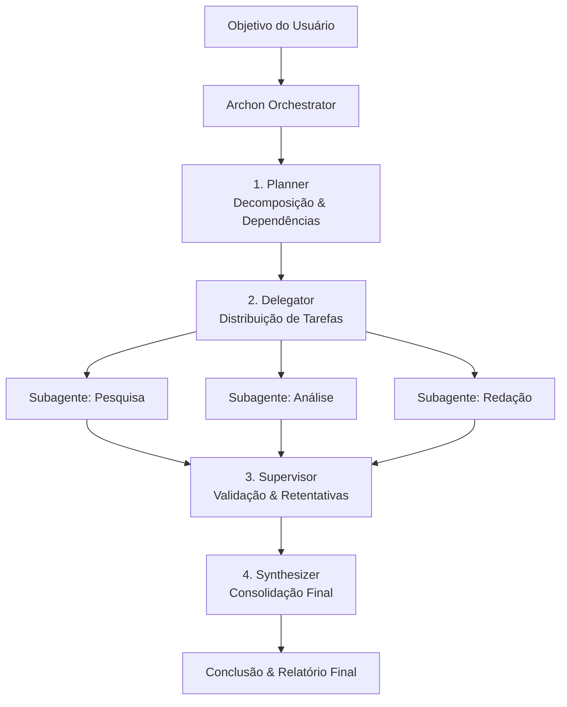

# Archon — Agente de Orquestração, Delegação, Planejamento e Supervisão

[](https://github.com/SEU-USUARIO/archon-agent/actions/workflows/ci.yml)
[](https://www.python.org/downloads/)
[](LICENSE)

**Archon** é um agente orquestrador projetado para coordenar fluxos de trabalho complexos de ponta a ponta. Ele recebe um objetivo de alto nível, estrutura o plano de execução, delega subtarefas a agentes especialistas, supervisiona a qualidade das entregas e consolida os resultados em uma conclusão clara e acionável.

## Principais Responsabilidades

1. **Planejamento (`Planner`)**: Decompõe objetivos complexos em subtarefas ordenadas, mapeando dependências e capacidades necessárias.
2. **Delegação (`Delegator`)**: Seleciona o subagente mais adequado para cada subtarefa e distribui responsabilidades de forma estruturada.
3. **Supervisão (`Supervisor`)**: Valida entregas contra critérios de qualidade, gerencia retentativas em caso de falhas e garante aderência ao escopo.
4. **Síntese (`Synthesizer`)**: Reúne os resultados validados de todos os subagentes e apresenta uma conclusão consolidada.

## Arquitetura



## Estrutura do Projeto

```text
archon-agent/
├── .github/workflows/ci.yml      # Pipeline de CI (lint + testes)
├── config/archon.yaml            # Configurações de orquestração e supervisão
├── prompts/
│   ├── system_prompt.md          # Prompt principal de identidade do Archon
│   ├── delegation_template.md    # Template de delegação para subagentes
│   └── synthesis_template.md     # Template de consolidação de resultados
├── src/archon/
│   ├── __init__.py
│   ├── models.py                 # Modelos de dados (Task, SubTask, Report, etc.)
│   ├── llm.py                    # Interface LLM plugável (Mock + OpenAI-compatível)
│   ├── planner.py                # Módulo de planejamento e decomposição
│   ├── delegator.py              # Módulo de roteamento e delegação
│   ├── supervisor.py             # Módulo de validação, revisão e retry
│   ├── synthesizer.py            # Módulo de síntese e conclusão
│   ├── subagents.py              # Interface BaseSubAgent e agentes de exemplo
│   ├── orchestrator.py           # Classe principal Archon
│   └── cli.py                    # Interface de linha de comando
├── examples/quickstart.py        # Exemplo completo pronto para executar
├── tests/test_archon.py          # Suíte de testes automatizados
├── pyproject.toml
├── requirements.txt
├── .env.example
├── CHANGELOG.md
├── CONTRIBUTING.md
└── LICENSE
```

## Instalação Rápida

```bash
git clone https://github.com/SEU-USUARIO/archon-agent.git
cd archon-agent
python -m venv .venv
source .venv/bin/activate  # No Windows: .venv\Scripts\activate
pip install -e ".[dev]"
```

Configure suas variáveis de ambiente (opcional — o Archon funciona em modo local/simulado sem chave de API):

```bash
cp .env.example .env
```

## Uso

### Via Python

```python
from archon import Archon, create_default_subagents

archon = Archon(subagents=create_default_subagents())
report = archon.run("Lançar um novo produto SaaS B2B no mercado brasileiro")

print(report.to_markdown())
```

### Via CLI

```bash
python -m archon.cli "Estruturar estratégia de expansão internacional para Q3"
```

### Executando o Exemplo

```bash
python examples/quickstart.py
```

## Testes

```bash
pytest -v
```

## Como Publicar no GitHub

```bash
git init
git add .
git commit -m "feat: initial release of Archon orchestration agent"
git branch -M main
git remote add origin https://github.com/SEU-USUARIO/archon-agent.git
git push -u origin main
```

## Licença

Distribuído sob a licença MIT. Veja [LICENSE](LICENSE) para mais informações.
